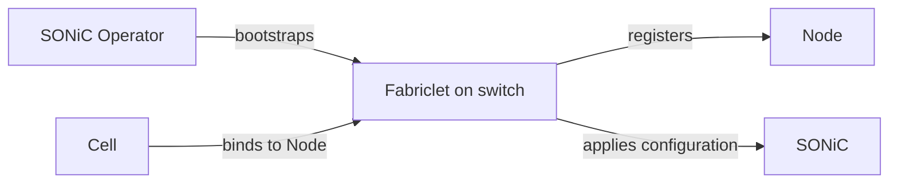

# Fabric and SONiC switches

Fabric models network configuration through three resources: `Node`,
`Interface`, and `Cell`. A Fabriclet runs on each switch and connects these
Kubernetes resources to a vendor-specific runtime such as SONiC.

Fabric currently treats an applied Cell as an immutable configuration unit. A
Cell is bound to a Node, applied as a whole, and deleted before a replacement
can be applied.

## The Fabric model

- A **Node** represents a switch.
- An **Interface** represents a switch port belonging to that Node.
- A **Cell** describes the fabric configuration assigned to the Node, including
  its identity, loopback addresses, prefixes, and peers.

The Fabriclet is expected to be running before a Cell is created. At startup it
registers its Node it was told to manage. Only one Cell can
be bound to a Node at a time.

For example, a Fabriclet started for `leaf-01` and `Ethernet0` registers
 Node resource equivalent to:

```yaml
apiVersion: fabric.ironcore.dev/v1alpha1
kind: Node
metadata:
  name: leaf-01
spec:
  providerID: sonic://leaf-01
---
apiVersion: fabric.ironcore.dev/v1alpha1
kind: Interface
metadata:
  name: Ethernet0
spec:
  nodeRef:
    name: leaf-01
  handle: sonic://Ethernet0
  adminState: Up
```



## Bootstrapping the Fabriclet

Fabric does not install software on the switch. The intended SONiC bootstrap
provider is [`sonic-operator`](https://github.com/ironcore-dev/sonic-operator),
which can use generated ZTP to start the Fabriclet as a Docker container.

An abbreviated `Switch` could look like this:

```yaml
apiVersion: sonic.networking.metal.ironcore.dev/v1alpha1
kind: Switch
metadata:
  name: leaf-01
spec:
  hostname: leaf-01
  ztp:
    sourceAddress: 192.0.2.11
  volumes:
  - name: sonic-config
    hostPath:
      path: /etc/sonic
      type: Directory
  containers:
  - name: fabriclet
    image: <registry>/fabriclet-sonic:<tag>
    hostPID: true
    securityContext:
      privileged: true
      runAsUser: 0
    volumeMounts:
    - name: sonic-config
      mountPath: /etc/sonic
    args:
    - --name=leaf-01
    - --interface=Ethernet0
    - --interface=Ethernet4
    injectControlKubeconfig: true
```

This is only one possible bootstrap path. Fabric and SONiC Operator do not
depend on each other's APIs; their handover is the running Fabriclet on the
switch.

## Applying a Cell

Once the Fabriclet has registered `leaf-01`, `Ethernet0`, and `Ethernet4`, a
small leaf configuration could look like this:

```yaml
apiVersion: fabric.ironcore.dev/v1alpha1
kind: Cell
metadata:
  name: leaf-01
  namespace: default
  labels:
    fabric.ironcore.dev/role: leaf
spec:
  nodeRef:
    name: leaf-01
  id: "42"
  hostname: leaf-01.fabric.example.com
  ips:
  - fd00:1234:5678:f2::
  prefixes:
  - fd00:1234:5678:f2::/64
  - fd00:1234:5678:f2:1::/80
  peers:
  - interfaceRef:
      name: Ethernet0
    dhcpRelay: fd00:1234:5678:3201::1
  - interfaceRef:
      name: Ethernet4
```

The first prefix is the advertised summary. Each peer with `dhcpRelay` is a
south-facing port and needs one additional prefix. Peers without `dhcpRelay`
are fabric-facing ports.

The Fabriclet claims the Node for this Cell, resolves the referenced
Interfaces, applies the complete switch configuration, and marks the Cell
`Active` when the runtime reports success.

## Replacing and deleting a Cell

An active Cell is not hot-updated. Editing its peers, prefixes, or other switch
configuration does not cause the Fabriclet to apply those changes again.

To change the configuration, delete the current Cell and create a replacement.
During deletion, the Cell finalizer keeps the object present while the runtime
resets the switch. The Cell then becomes `Expired`, its finalizer is removed,
and the Node is released. The Node and Interface objects remain registered and
the Node can accept the next Cell.
